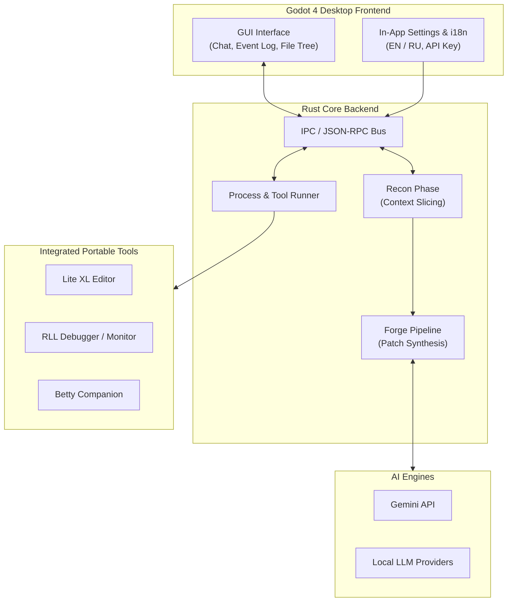

# Black Betty (BB)

A high-performance, modular desktop AI agent workspace designed for autonomous coding, architectural analysis, and developer tooling integration. 

Black Betty pairs an event-driven **Rust** backend with a lightweight, responsive **Godot 4** GUI to deliver an out-of-the-box development environment.

---

## Architecture Overview



### Key Highlights
- **Two-Stage Context Slicing**: Utilizes a targeted Recon phase to identify and extract precise code slices before synthesizing patches in the Forge pipeline.
- **In-App API Configuration**: Zero configuration files needed — enter and manage your API keys directly through the frontend Settings dialog.
- **Multilingual UI**: Native support for both **English** and **Russian** out of the box.
- **Portable "Out-of-the-Box" Tooling**: Ships with self-contained, pre-configured portable tools located in `tools/`:
  - **Lite XL**: Lightweight, fast code editor integrated into the workflow.
  - **RLL (Reg Life Log)**: Dedicated diagnostic debugger and process inspector.
  - **Betty Companion**: Web companion assistant.
- **Robust Event Bus**: Non-blocking asynchronous message bus orchestrating state between the Rust backend and Godot frontend.

---

## Directory Structure

```text
BB/
├── betty_backend/        # Rust core backend (engine, IPC, AI pipelines)
├── betty_frontend/       # Godot 4 desktop user interface (with i18n support)
├── tools/                # Portable out-of-the-box workspace binaries
│   ├── betty_companion/  # Companion utility
│   ├── lite-xl/          # Portable code editor
│   └── RLLTool/          # Diagnostic logging & debugging suite
├── architecture.yaml     # System architecture specifications
└── .gitignore            # Clean environment & artifact filters
```

---

## Getting Started

### Prerequisites
- [Rust toolchain](https://www.rust-lang.org/) (latest stable)
- [Godot Engine 4.x](https://godotengine.org/) (Standard 64-bit)

### Running Locally
1. **Start the Backend**:
   ```bash
   cd betty_backend
   cargo run --release
   ```
2. **Launch the Frontend**:
   Open `betty_frontend/project.godot` inside Godot Engine 4 and run the project (`F5`), or execute the compiled frontend binary.
3. **Configure**:
   Open the **Settings Dialog** in the UI, select your preferred language (**English** / **Russian**), paste your Gemini API key, and you're good to go!

---

## License
MIT License. Free to use, adapt, and build upon.